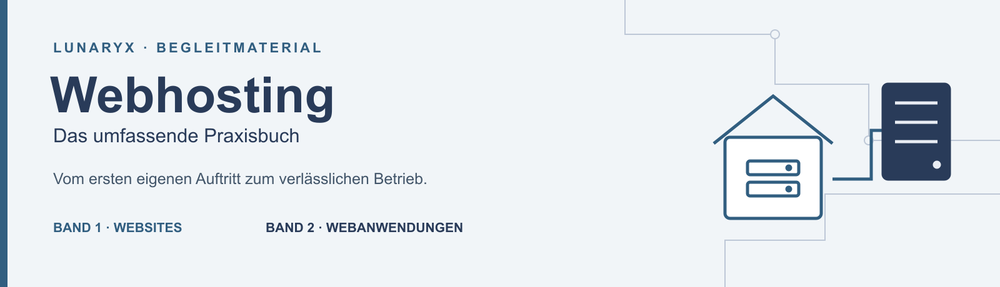

# Vom Lesen zum eigenen Webprojekt

Willkommen bei den Begleitmaterialien zu **Webhosting – Das umfassende Praxisbuch** von Franz Claus. Hier finden Sie die Dateien aus dem Werkstattbeispiel, Arbeitsvorlagen, Übungen mit Lösungen und verständlich aufbereitete Testberichte. Wählen Sie einfach den Band, mit dem Sie gerade arbeiten.

| Ihr Buch | Hier beginnen | Alles für diesen Band herunterladen |
|---|---|---|
| **Band 1** · Websites aufbauen und sicher betreiben | [Material für Band 1](band-1/README.md) | [Band 1 als ZIP](pakete/Webhosting_Band_1_Begleitmaterial.zip) |
| **Band 2** · Webanwendungen betreiben und Abläufe automatisieren | [Material für Band 2](band-2/README.md) | [Band 2 als ZIP](pakete/Webhosting_Band_2_Begleitmaterial.zip) |

**Neu auf GitHub?** Die [kurze Starthilfe](START.md) führt Sie zum richtigen Download. Zum Lesen und Herunterladen benötigen Sie weder ein GitHub-Konto noch Git-Kenntnisse.

## Was möchten Sie gerade tun?

- **Am eigenen Projekt arbeiten:** Beginnen Sie im Bereich Ihres Bandes. Die Kapitel im Buch erklären Vorbereitung, Durchführung und Rückweg.
- **Eine Erklärung nachprüfen:** Die [Testberichte](pruefungen/README.md) zeigen, was tatsächlich ausprobiert wurde und wo die Aussage endet.
- **Das Buch probelesen:** Im [Leitfaden für Testleser](mitmachen/README.md) finden Sie überschaubare Aufgaben und eine Rückmeldevorlage.
- **Einen Fehler melden:** Die [Hinweise für Rückmeldungen](RUECKMELDUNG.md) helfen, die betreffende Stelle eindeutig zu beschreiben.

Die Beispiele arbeiten mit erfundenen Werkstattdaten. Persönliche Zugänge und echte Kundendaten werden dafür nicht benötigt. Ihre ausgefüllten Betriebsunterlagen behalten Sie bei sich.

**Materialfassung 2026.10.12-r4 · 12. Oktober 2026.** Sie gehört zum Textstand beider Bände vom 12. Oktober 2026. Welche Änderungen später hinzukommen, steht in den [Änderungshinweisen](AENDERUNGEN.md). [Fassungszuordnung und Prüfsummen](VERSION.md) helfen, Buch und Download zusammenzuhalten.
